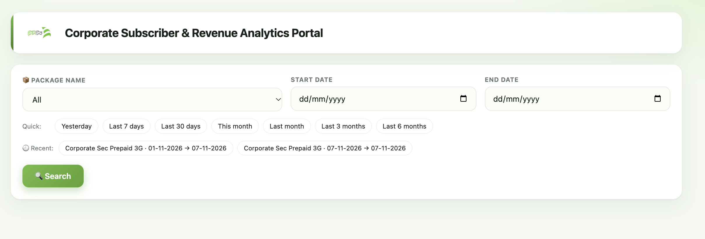
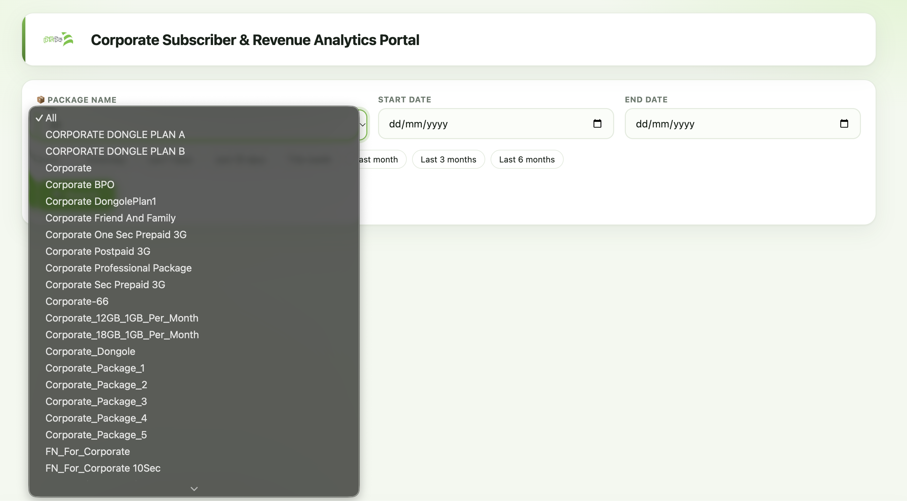
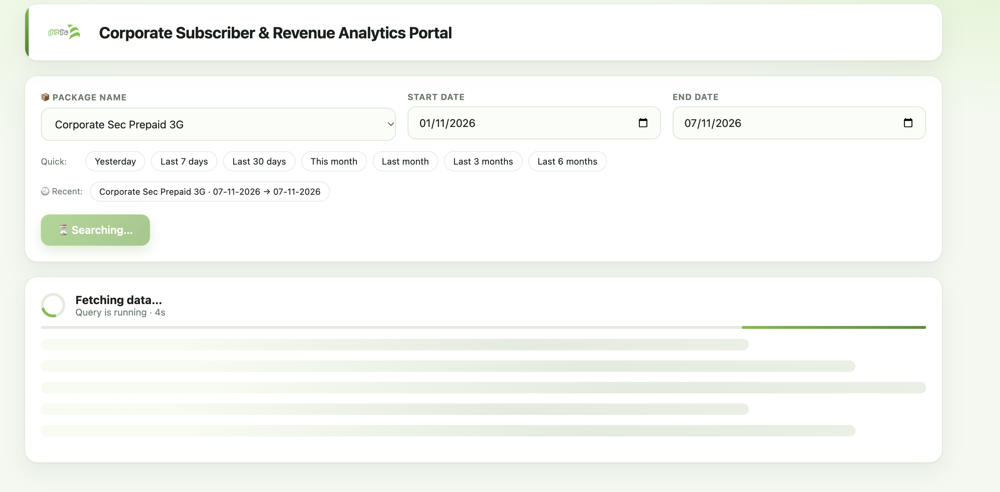
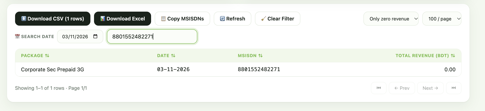
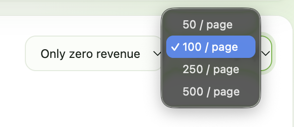

<div align="center">


# 📊 Corporate Subscriber & Revenue Analytics Portal

**A fast, self-service web portal for exploring corporate package subscribers and their day-wise revenue, with one-click Excel and CSV exports.** ⚡


</div>

---

## 🌟 Overview

The **Corporate Subscriber & Revenue Analytics Portal** lets business and BI users pull subscriber-level revenue for any **Corporate** package straight from the Data Warehouse, without writing a single SQL query.

Pick a package 📦, choose a date range 📅, hit **Search** 🔍, then filter, sort, copy MSISDNs, or download a ready-to-share Excel report with a summary, Top 10 ranking and native charts 📈.

---

## 🖼️ Overview


| 🔍 Search Panel | 📦 Package Dropdown |
|:---:|:---:|
|  |  |

| ⏳ Live Query Progress | 📋 Results Table & Filters |
|:---:|:---:|
|  |  |

| 📄 Page Size Options |
|:---:|
|  |

---

## ✨ Features

### 🔎 Search & Filtering
- 📦 **Package selector**: dynamically loaded from the DWH (every offering containing "Corporate"), or search across **All** packages.
- 📅 **Date range picker** with **quick presets**: Yesterday, Last 7 days, Last 30 days, This month, Last month, Last 3 months, Last 6 months.
- 🕘 **Recent searches**: your last searches are remembered in the browser for one-click re-run.
- ⏱️ **Live query status** with a running timer and loading skeleton.
- 💰 **Revenue filter**: All revenue / Hide zero revenue / Only zero revenue.
- 🔍 **In-table search** by MSISDN or package, plus a **single-date** filter.
- ↕️ **Sortable columns** and configurable pagination (**50 / 100 / 250 / 500** rows per page).
- 🧹 **Clear Filter** and 🔄 **Refresh** (bypass cache) controls.

### 📥 Export & Productivity
- ⬇️ **Download CSV** that respects the filters currently applied.
- 📊 **Download Excel (.xlsx)** with multiple sheets and native charts (see below).
- 📋 **Copy MSISDNs** to the clipboard in one click.
- 🏷️ Smart, readable file names, e.g. `Corporate_Sec_Prepaid_3G_01-11-2026_to_05-11-2026_Zero_Revenue.xlsx`.

### 🚀 Performance
- 🔌 **Connection pooling** for Oracle (no reconnect on every search).
- 📦 **Bulk fetching** with large array sizes for fast reads.
- 🧠 **In-memory result cache** (gzip-compressed, TTL-based, LRU-limited) so repeating a search is instant.
- 🤝 **Request de-duplication**: if several users run the same search simultaneously, the database is queried only once.
- 🗜️ **Gzip responses** to the browser for smaller payloads.
- 🛡️ Safety limit on result size (`MAX_ROWS`) and a 5-minute query timeout.

### 📑 Excel Report Contents

| Sheet | What's inside |
|---|---|
| 👥 **Subscribers** | Full day-wise data: Package, Date, MSISDN, Total Revenue (BDT). Auto-filter, frozen header, MSISDN stored as text. Automatically continues on a new sheet beyond Excel's row limit. |
| 📝 **Summary** | Package, period, applied filter, unique subscribers, total revenue, average and highest revenue per subscriber, generation time. |
| 🏆 **Top 10** | Top 10 subscribers by revenue with a bar chart. |
| 📦 **By Package** *(All packages)* | Revenue and subscriber count per package with two bar charts. |
| 📊 **Distribution** *(single package)* | Subscriber count by revenue range, with a column chart. |

---

## 🛠️ Tech Stack

| Layer | Technology |
|---|---|
| 🐍 Backend | Python, Flask |
| 🗄️ Database | Oracle Data Warehouse via `oracledb` |
| 📗 Excel Export | `xlsxwriter` |
| 🎨 Frontend | HTML, CSS and vanilla JavaScript (single template) |

---

## 📁 Project Structure

```
Corporate_Portal_V2/
├── app.py              # Flask app: routes, validation, caching, export endpoint
├── utility.py          # Oracle connection pool, package list, revenue query
├── export.py           # Excel workbook builder (sheets + charts)
├── templates/
│   └── portal.html     # Portal UI
├── static/
│   └── teletalk.png    # Logo
├── docs/
│   └── screenshots/    # README images
├── requirements.txt
└── README.md
```

---

## 🚀 Getting Started

### ✅ Prerequisites
- Python **3.11+**
- Network access to the Oracle DWH
- Read access to `subscriber_usage_analysis`, `offer_dim` and `date_dim`

### 💻 Installation

```bash
# 1. Clone the repository
git clone https://github.com/<your-org>/Corporate_Portal_V2.git
cd Corporate_Portal_V2

# 2. (Optional) create a virtual environment
python -m venv venv
source venv/bin/activate        # Windows: venv\Scripts\activate

# 3. Install dependencies
pip install -r requirements.txt
```

### ⚙️ Configuration

All settings are read from environment variables:

| Variable | Description | Default |
|---|---|---|
| `DB_USER_203` | Oracle username | `****` |
| `DB_PASS_203` | Oracle password | `****` |
| `DB_SVC_203` | Oracle DSN (`host:port/service`) | `****` |
| `PORT` | Port the portal runs on | `5005` |
| `CACHE_TTL` | Result cache lifetime in seconds | `300` |
| `CACHE_MAX` | Max cached searches | `30` |
| `MAX_ROWS` | Max rows allowed per search | `1000000` |

```bash
export DB_USER_203="your_user"
export DB_PASS_203="your_password"
export DB_SVC_203="host:1521/service_name"
```

> 🔐 **Never commit credentials.** Keep them in environment variables or a local `.env` file (already in `.gitignore`).

### ▶️ Run

```bash
python app.py
```

Open **http://localhost:5005** in your browser 🌐

---

## 🔌 API Reference

| Method | Endpoint | Description |
|---|---|---|
| `GET` | `/` | Portal UI |
| `GET` | `/api/packages` | List of corporate packages (`?refresh=1` to reload) |
| `POST` | `/api/search` | Run a search. Body: `package`, `start_date`, `end_date`, optional `refresh` |
| `GET` | `/api/export` | Download the Excel report. Params: `package`, `start_date`, `end_date`, `rev`, `q`, `d`, `pk` |

### ⚠️ Validation rules
- Dates must be valid and the **Start Date cannot be after the End Date**.
- **Today's data is not available**; the End Date must be up to **yesterday**.
- The package must exist in the corporate package list.

---

## 🧮 How Revenue Is Calculated

For each **package + date + subscriber**:

```
Total Revenue = Voice Revenue + Data Revenue + SMS Revenue + Combo Bundle Revenue
```

MSISDNs are normalised to the `880XXXXXXXXXX` format 📱.

---

## 👩‍💻👨‍💻 Developed By

<table>
  <tr>
    <td align="center" width="260">
      <b>Anamika Saha</b><br/>
      BI & Data Platform Engineer
    </td>
    <td align="center" width="260">
      <b>Ridwanul Islam (Sanji)</b><br/>
      BI & Data Platform Engineer
    </td>
  </tr>
</table>

---

<div align="center">

💚 Built with care for the Teletalk BI & Data Platform team.

</div>